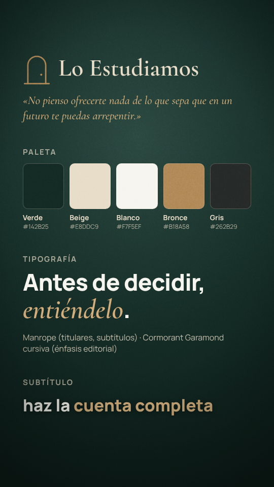

# Contenido Inmobiliario

Motor de producción audiovisual de una marca personal **sin rostro** de asesoramiento inmobiliario,
educación financiera y decisiones inteligentes (Roquetas de Mar · Aguadulce · Almería).
Vídeos verticales 1080×1920 para Reels, TikTok y Shorts, producidos **por código** (Remotion + React + Three.js)
con voz en off de ElevenLabs, subtítulos sincronizados palabra a palabra y música original.

> «No pienso ofrecerte nada de lo que sepa que en un futuro te puedas arrepentir. Lo estudiamos juntos.»



## Qué hay
- **3 vídeos piloto** en `contenido/videos/` (P01 cinematográfico, P02 motion graphics, P03 3D), cada uno con
  `guion.yaml`, `editorial.yaml`, voz, tiempos, subtítulos `.srt` y `ENTREGA.md` (formato de entrega de 9 puntos).
- **Motor** (`motor/`): 12 escenas configurables, subtítulos dinámicos, firma de marca, transiciones, mezcla con
  atenuación automática de la música, identidad centralizada en `src/marca/tokens.ts`.
- **Herramientas** (`herramientas/`): post-proceso de voz, alineación con faster-whisper, música y efectos
  generados por código, control de calidad técnico.
- **Normativa** (`docs/`): directivas íntegras, identidad, sistema editorial, verificación de datos, licencias.
- **Claude** (`CLAUDE.md`, `.claude/`): agentes (estratega, guionista, director de arte, verificador, auditor) y
  skills (`nuevo-video`, `semana`, `auditar`, `verificar-dato`).

## Empezar
```bash
cd motor && npm ci
cd .. && python3 -m venv .venv && .venv/bin/pip install -r herramientas/requirements.txt
cd motor
npm run producir -- ../contenido/videos/P01-casa-de-tus-suenos --render   # → salida/P01-casa-de-tus-suenos.mp4
npm run studio                                                            # editor visual de Remotion
```
Flujo completo: [`docs/flujo-de-trabajo.md`](docs/flujo-de-trabajo.md).

## Coste
0 € adicionales: todo es software libre o propio, salvo la voz, que usa el plan de ElevenLabs ya contratado
(≈ 700 créditos por vídeo de 45 s). Detalle de licencias: [`docs/herramientas.md`](docs/herramientas.md).
Remotion es gratuito para equipos de hasta 3 personas.
